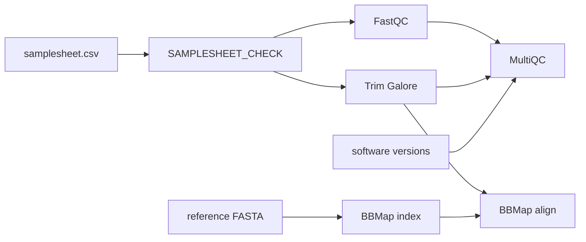

# nextflow-workshop-lnu

A small, runnable [Nextflow](https://www.nextflow.io/) (DSL2) pipeline built on the
[nf-core](https://nf-co.re/) template and modules, made for a training workshop at
Linnaeus University. It takes Illumina FASTQ files, checks and trims the reads, aligns them
to a reference genome, and summarises the quality metrics in a single MultiQC report.

It is meant to be read, run and modified: every step is a stock nf-core module, so the
workshop code stays short and shows how the pieces of a real pipeline fit together
(samplesheet validation → modules → channels → config → reports).

## Pipeline overview



1. Samplesheet validation (`bin/check_samplesheet.py`)
2. Raw read QC ([`FastQC`](https://www.bioinformatics.babraham.ac.uk/projects/fastqc/))
3. Adapter and quality trimming ([`Trim Galore`](https://www.bioinformatics.babraham.ac.uk/projects/trim_galore/))
4. Reference indexing and read alignment ([`BBMap`](https://sourceforge.net/projects/bbmap/))
5. Aggregated report ([`MultiQC`](https://multiqc.info/)), including software versions

## Requirements

- [Nextflow](https://www.nextflow.io/docs/latest/install.html) `>= 24.04.0` (and Java 17+)
- One of Docker, Singularity/Apptainer, Podman or Conda/Mamba

> **Nextflow 25.10 and later:** the pipeline still uses the nf-core 2023 template, which relies on
> the classic script syntax. Newer Nextflow releases default to the strict syntax parser and refuse
> to load it, so run with `export NXF_SYNTAX_PARSER=v1` until the pipeline is ported.

## Quick start

Test the setup with the bundled minimal dataset (a SARS-CoV-2 read pair from the
[nf-core test-datasets](https://github.com/nf-core/test-datasets)):

```bash
nextflow run danilodileo/nextflow-workshop-lnu -profile test,docker --outdir results
```

Run on your own data:

```bash
nextflow run danilodileo/nextflow-workshop-lnu \
    -profile docker \
    --input samplesheet.csv \
    --ref_genome genome.fasta \
    --outdir results
```

### Samplesheet

A comma-separated file with a header row and three columns (leave `fastq_2` empty for single-end
reads):

```csv
sample,fastq_1,fastq_2
SAMPLE1,sample1_R1.fastq.gz,sample1_R2.fastq.gz
SAMPLE2,sample2_R1.fastq.gz,
```

Paths can be local files or URLs; files must end in `.fq.gz` or `.fastq.gz`.

### Main parameters

| Parameter        | Description                                                     |
| ---------------- | --------------------------------------------------------------- |
| `--input`        | Samplesheet (see above). **Required.**                          |
| `--ref_genome`   | Reference genome FASTA used by BBMap. **Required.**             |
| `--outdir`       | Directory where results are published. **Required.**            |
| `--multiqc_title`| Optional title for the MultiQC report.                          |

Run `nextflow run danilodileo/nextflow-workshop-lnu --help` for the complete list.

Limit the resources a run may request (for a laptop or CI) with a small config passed with `-c`:

```groovy
process.resourceLimits = [cpus: 4, memory: '16.GB', time: '4.h']
```

## Output

Results are published under `--outdir`:

| Directory       | Content                                                            |
| --------------- | ------------------------------------------------------------------ |
| `fastqc/`       | FastQC reports for the raw reads                                   |
| `trimgalore/`   | Trimmed reads and trimming reports                                 |
| `bbmap/`        | Alignments (`*.bam`) and BBMap logs                                |
| `multiqc/`      | `multiqc_report.html` summarising FastQC and trimming statistics   |
| `pipeline_info/`| Nextflow execution reports, parameters and `software_versions.yml` |

See [`docs/output.md`](docs/output.md) for details and [`docs/usage.md`](docs/usage.md) for more
on running the pipeline.

## Credits

Written by Danilo Di Leo. Built on the [nf-core](https://nf-co.re/) template and modules
([Ewels *et al.*, 2020](https://doi.org/10.1038/s41587-020-0439-x)). Tool citations are listed in
[`CITATIONS.md`](CITATIONS.md).

## License

Released under the MIT License, see [`LICENSE`](LICENSE).
