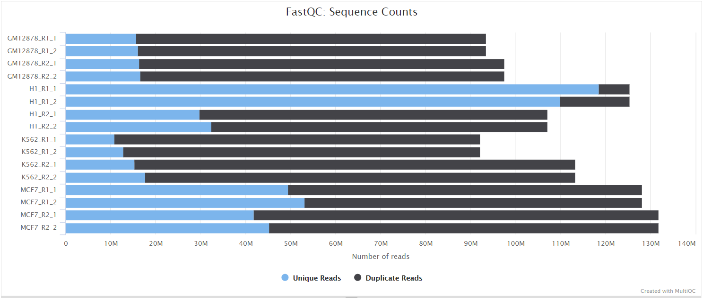
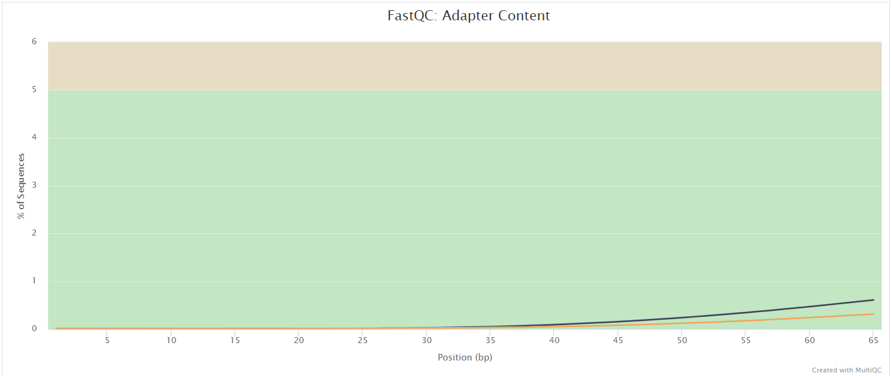

# nextflow-workshop-lnu: Output

All paths are relative to the directory given with `--outdir`.

## Pipeline overview

- [FastQC](#fastqc): raw read QC
- [Trim Galore](#trim-galore): adapter and quality trimming
- [BBMap](#bbmap): alignment to the reference genome
- [MultiQC](#multiqc): one report for the whole run
- [Pipeline information](#pipeline-information): execution reports and software versions

### FastQC

- `fastqc/`
  - `*_fastqc.html`: report with the quality metrics of each read file.
  - `*_fastqc.zip`: archive with the report data and plots.

[FastQC](https://www.bioinformatics.babraham.ac.uk/projects/fastqc/) reports per-base quality, GC
content, adapter contamination and over-represented sequences. The FastQC plots in the MultiQC
report show the _untrimmed_ reads.

### Trim Galore

- `trimgalore/`
  - `*_val_*.fq.gz` (paired-end) or `*_trimmed.fq.gz` (single-end): trimmed reads used for mapping.
  - `*_trimming_report.txt`: adapters found and bases removed, summarised in MultiQC by the Cutadapt module.

### BBMap

- `bbmap/`
  - `<sample>.bam`: alignments to the reference genome.
  - `<sample>.bbmap.log`: BBMap run log with mapping statistics.

The reference index is an intermediate result and is not published.

### MultiQC

- `multiqc/`
  - `multiqc_report.html`: standalone report, open it in a browser.
  - `multiqc_data/`: parsed statistics for every tool.
  - `multiqc_plots/`: static versions of the report plots.

[MultiQC](https://multiqc.info) combines the FastQC and Trim Galore results of all samples and
adds the workflow summary, the methods description and the software versions.

### Pipeline information

- `pipeline_info/`
  - `execution_report_*.html`, `execution_timeline_*.html`, `execution_trace_*.txt`, `pipeline_dag_*.html`: Nextflow run reports.
  - `software_versions.yml`: version of every tool used in the run.
  - `samplesheet.valid.csv`: the validated samplesheet used as input.
  - `params_*.json`: parameters of the run.
  - `pipeline_report.html` / `.txt`: only written when `--email` or `--email_on_fail` is used.
